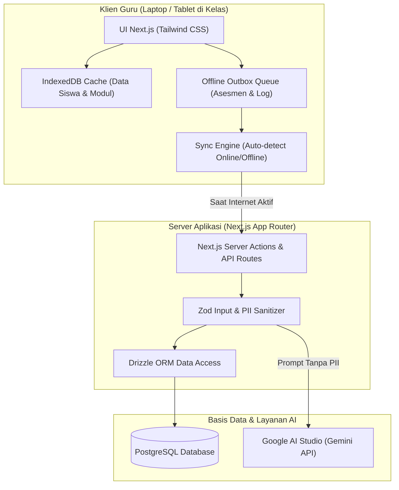

# Dokumen Arsitektur Sistem: Multigrade Cerdas AI
## SDN SEDAENG II Tosari

---

## 1. Ringkasan Arsitektur

Multigrade Cerdas AI dirancang dengan arsitektur **Offline-Resilient Web Application** yang dioptimalkan untuk kondisi geografis Tosari dengan konektivitas tidak stabil. Sistem ini menggunakan **Next.js App Router (React 19, TypeScript)**, **PostgreSQL** dengan **Drizzle ORM**, dan **Google AI Studio (Gemini API)** di sisi server.



---

## 2. Struktur Modul & Pembagian Kelompok Multigrade

Aplikasi disusun berdasarkan 3 kelompok belajar terpadu sesuai karakteristik SDN SEDAENG II Tosari (total 27 siswa):

| Kelompok | Tingkatan Kelas | Fase Kurikulum Merdeka | Karakteristik Diferensiasi Belajar |
|---|---|---|---|
| **Kelompok A** | Kelas 1 & Kelas 2 | **Fase A** | Fondasi literasi & numerasi konkret. Guru memberikan instruksi verbal/visual langsung pada kelas 1, sementara kelas 2 mengerjakan lembar aktivitas semi-mandiri atau tutor terbimbing. |
| **Kelompok B** | Kelas 3 & Kelas 4 | **Fase B** | Konseptual dan integrasi IPAS. Satu topik payung (contoh: Siklus Air atau Ekosistem Sekitar Tosari), di mana kelas 3 fokus observasi deskriptif dan kelas 4 fokus penalaran sebab-akibat. |
| **Kelompok C** | Kelas 5 & Kelas 6 | **Fase C** | Literasi analitis, numerasi pemecahan masalah, dan proyek P5. Kelas 6 diberdayakan menjadi tutor sebaya (*peer tutors*) untuk kelas 5 dalam pengerjaan proyek terpadu. |

---

## 3. Strategi Offline-Resilient (Tosari Network Context)

Karena koneksi internet di desa Sedaeng Tosari sering terganggu oleh kabut tebal, hujan, atau kendala sinyal seluler, arsitektur offline dirancang sebagai berikut:

1. **Local-First Data Capture:**
   * Saat guru menginput asesmen harian, observasi sikap, atau absensi, data pertama kali divalidasi oleh Zod dan disimpan langsung di **IndexedDB** browser lokal.
   * UI langsung memberikan umpan balik sukses tanpa menunggu *network roundtrip*.

2. **Outbox Pattern:**
   * Setiap operasi mutasi (tambah nilai, perbarui modul) diberi status `pending` dan dimasukkan ke dalam antrean `offline_sync_logs`.
   * Event listener `window.addEventListener('online', ...)` memicu proses sinkronisasi latar belakang (*background sync*).

3. **Resolusi Konflik:**
   * Menggunakan prinsip *Last-Write-Wins (LWW)* berbasis timestamp terenkripsi dari perangkat guru utama.
   * Karena setiap guru memegang satu kelompok kelas rangkap tetap, potensi benturan data antar guru sangat minim.

4. **AI Caching & Offline Generation Fallback:**
   * Modul ajar yang di-generate oleh Google AI Studio disimpan secara persisten di cache lokal agar dapat dibuka kembali di kelas tanpa memerlukan koneksi internet ulang.

---

## 4. Integrasi Google AI Studio (Gemini API)

Google AI Studio dimanfaatkan sebagai asisten perencana pengajaran kelas rangkap (*Multigrade Co-Teacher*):
1. **Diferensiasi Modul Otomatis:** Guru memasukkan 1 topik (misal: "Keanekaragaman Hayati Taman Nasional Bromo Tengger Semeru"). AI menghasilkan rencana kegiatan ganda (kegiatan kelas A vs kelas B dalam satu waktu alokasi 70 menit).
2. **Sanitasi Prompt (Zero-PII):** Tidak ada nama siswa, NISN, atau informasi pribadi yang dikirim ke Google AI Studio. Prompt hanya berisi fase, topik, dan tingkat pemahaman umum (misal: "3 siswa memerlukan perancah visual, 4 siswa pengayaan mandiri").
3. **Penyimpanan Kunci API:** `GEMINI_API_KEY` dikelola strictly pada lingkungan server / backend action (`process.env.GEMINI_API_KEY`), tidak pernah terekspos ke klien.

---

## 5. Struktur Folder Repositori

```text
MULTIGRADE CERDAS/
├── .env.example                # Template variabel lingkungan
├── .gitignore                  # Berkas yang diabaikan Git
├── drizzle.config.ts           # Konfigurasi migrasi Drizzle ORM
├── next.config.mjs             # Konfigurasi Next.js 15
├── package.json                # Dependensi proyek
├── postcss.config.mjs          # Konfigurasi PostCSS
├── tailwind.config.ts          # Desain sistem Tailwind CSS
├── tsconfig.json               # Konfigurasi TypeScript ketat
│
├── src/
│   ├── app/                    # Next.js App Router
│   │   ├── globals.css         # Styling global Tailwind
│   │   ├── layout.tsx          # Shell layout utama aplikasi
│   │   ├── page.tsx            # Halaman kesiapan & ringkasan operasional
│   │   ├── kelompok-a/         # Rute manajemen Fase A (Kelas 1 & 2)
│   │   ├── kelompok-b/         # Rute manajemen Fase B (Kelas 3 & 4)
│   │   ├── kelompok-c/         # Rute manajemen Fase C (Kelas 5 & 6)
│   │   └── api/                # Endpoint API sinkronisasi & asisten AI
│   │
│   ├── components/             # Komponen UI modular
│   │   ├── ui/                 # Komponen atomik (button, card, dialog, badge)
│   │   ├── multigrade/         # Komponen spesifik kelas rangkap
│   │   └── offline/            # Indikator status koneksi & antrean sinkronisasi
│   │
│   ├── db/                     # Lapisan Basis Data
│   │   ├── index.ts            # Inisialisasi klien PostgreSQL Drizzle
│   │   └── schema.ts           # Definisi skema tabel relasional
│   │
│   ├── lib/                    # Logika Inti & Utilitas
│   │   ├── utils.ts            # Helper utilitas UI (cn, tailwind-merge)
│   │   ├── ai/                 # Klien Google AI Studio & generator prompt
│   │   ├── offline/            # Engine IndexedDB & sinkronisasi outbox
│   │   └── validations/        # Skema Zod untuk validasi data input
│   │
│   └── types/                  # Definisi tipe TypeScript domain
│
├── ARCHITECTURE.md             # Dokumen arsitektur sistem
├── DATABASE_DESIGN.md          # Dokumen skema database relasional
├── IMPLEMENTATION_STATUS.md    # Matriks status implementasi fitur
├── PROJECT_PLAN.md             # Rencana proyek & tahap commit
└── SECURITY_PLAN.md            # Rencana keamanan & perlindungan privasi
```
