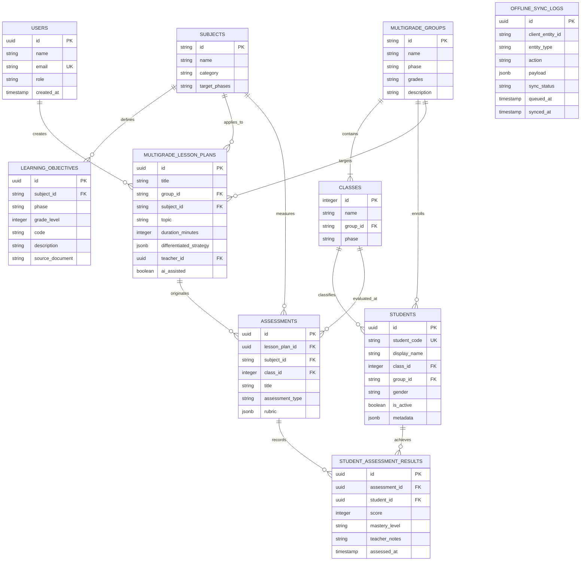

# Desain Basis Data: Multigrade Cerdas AI
## SDN SEDAENG II Tosari

---

## 1. Diagram Hubungan Entitas (ERD)



---

## 2. Rincian Kamus Data & Spesifikasi Tabel

### 2.1. Tabel `multigrade_groups`
Menyimpan struktur 3 rombongan belajar kelas rangkap SDN SEDAENG II Tosari.
* `id` (VARCHAR/TEXT, PK): Kode unik (`group-a`, `group-b`, `group-c`).
* `name` (TEXT, NOT NULL): Nama kelompok (`Kelompok A`, `Kelompok B`, `Kelompok C`).
* `phase` (TEXT, NOT NULL): Fase Kurikulum Merdeka (`Fase A`, `Fase B`, `Fase C`).
* `grades` (TEXT, NOT NULL): Kombinasi tingkatan kelas (`1,2`, `3,4`, `5,6`).
* `description` (TEXT): Deskripsi penataan ruang dan strategi pengajaran.

### 2.2. Tabel `classes`
Tingkatan kelas individu 1 sampai dengan 6.
* `id` (INTEGER, PK): Angka kelas 1 s/d 6.
* `name` (TEXT, NOT NULL): Label kelas (misal: "Kelas 1").
* `group_id` (TEXT, FK -> `multigrade_groups.id`): Kelompok induk.
* `phase` (TEXT, NOT NULL): Fase sesuai regulasi Kemendikbudristek.

### 2.3. Tabel `students` (Privasi Ketat & Nol PII)
Menampung data 27 siswa SDN SEDAENG II Tosari dengan proteksi data pribadi.
* `id` (UUID, PK): Identifier internal sistem.
* `student_code` (TEXT, UNIQUE, NOT NULL): Kode unik anonim (contoh: `SDN2-A-01` sampai `SDN2-C-27`).
* `display_name` (TEXT, NOT NULL): Nama panggil atau inisial untuk interaksi guru di kelas tanpa mengekspos identitas lengkap ke pihak ketiga.
* `class_id` (INTEGER, FK -> `classes.id`): Tingkat kelas terdaftar.
* `group_id` (TEXT, FK -> `multigrade_groups.id`): Kelompok kelas rangkap tempat siswa beraktivitas.
* `gender` (TEXT, NOT NULL): Jenis kelamin (`L` / `P`).
* `is_active` (BOOLEAN, DEFAULT true): Status keaktifan belajar.
* `metadata` (JSONB): Catatan gaya belajar atau preferensi modalitas (auditori/visual/kinestetik) tanpa data medis/pribadi sensitif.

### 2.4. Tabel `subjects`
Mata pelajaran resmi tingkat Sekolah Dasar:
* `id` (TEXT, PK): Slug mata pelajaran (misal: `bahasa-indonesia`, `matematika`, `ipas`, `pendidikan-pancasila`, `seni-budaya`, `pjok`, `bahasa-inggris`, `muatan-lokal-jawa`).
* `name` (TEXT, NOT NULL): Nama lengkap mata pelajaran.
* `category` (TEXT, NOT NULL): Kategori (`wajib`, `pilihan`, `muatan-lokal`).
* `target_phases` (TEXT, NOT NULL): Fase yang diajar (misal: `A,B,C` atau khusus `B,C` untuk IPAS).

### 2.5. Tabel `learning_objectives` (TP Resmi - Anti Halusinasi)
Menampung Tujuan Pembelajaran (TP) yang diturunkan dari Capaian Pembelajaran (CP) sah.
* **Aturan Mutlak:** Tidak ada CP buatan/palsu. Data hanya diisi melalui rujukan resmi Keputusan Kepala BSKAP No. 032/H/KR/2024.
* `id` (UUID, PK): Identifier TP.
* `subject_id` (TEXT, FK -> `subjects.id`): Mata pelajaran terkait.
* `phase` (TEXT, NOT NULL): Fase kurikulum.
* `grade_level` (INTEGER): Target kelas spesifik (jika berlaku).
* `code` (TEXT, NOT NULL): Kode penomoran TP terstruktur (misal: `TP-MAT-A-01`).
* `description` (TEXT, NOT NULL): Rumusan kompetensi resmi.
* `source_document` (TEXT): Rujukan regulasi pemerintah untuk menjamin keabsahan kurikulum.

### 2.6. Tabel `multigrade_lesson_plans`
Rencana Pelaksanaan Pembelajaran (Modul Ajar) terpadu kelas rangkap.
* `id` (UUID, PK): Identifier modul ajar.
* `title` (TEXT, NOT NULL): Judul tema pembelajaran.
* `group_id` (TEXT, FK -> `multigrade_groups.id`): Sasaran kelompok kelas rangkap.
* `subject_id` (TEXT, FK -> `subjects.id`): Mata pelajaran.
* `topic` (TEXT, NOT NULL): Topik bersama (misal: "Lingkungan Alam Tosari").
* `duration_minutes` (INTEGER, DEFAULT 70): Alokasi durasi tatap muka.
* `differentiated_strategy` (JSONB, NOT NULL):
  ```json
  {
    "commonConcept": "Konsep inti bersama",
    "lowerGradeActivity": {
      "grade": 3,
      "mode": "direct_instruction",
      "steps": ["Pengamatan daun", "Pencatatan visual"]
    },
    "upperGradeActivity": {
      "grade": 4,
      "mode": "independent_task",
      "steps": ["Klasifikasi bentuk tulang daun", "Pembuatan bagan rantai makanan"]
    },
    "peerTutoringNotes": "Siswa kelas 4 mendampingi siswa kelas 3 saat sesi presentasi bersama"
  }
  ```
* `ai_assisted` (BOOLEAN): Penanda apakah dibantu oleh Google AI Studio.
* `ai_prompt_summary` (TEXT): Ringkasan prompt tanpa data pribadi.

### 2.7. Tabel `assessments` & `student_assessment_results`
Pencatatan evaluasi pembelajaran formatif harian:
* Mendukung penilaian observasi cepat di kelas (*rubric-based fast entry*), sangat ideal untuk sekolah dengan 27 siswa di mana guru dapat menandai kemajuan (*perlu bimbingan*, *cukup*, *baik*, *sangat baik*) dalam hitungan detik.

### 2.8. Tabel `offline_sync_logs`
Tabel antrean sinkronisasi untuk menjamin keandalan data saat jaringan Tosari mati:
* `client_entity_id`: ID lokal yang di-generate di browser.
* `entity_type`: Tipe data yang disinkronisasi.
* `action`: Operasi (`insert`, `update`, `delete`).
* `payload`: Data JSON payload.
* `sync_status`: `pending`, `synced`, `conflict`, `failed`.
* `queued_at` & `synced_at`: Timestamp pelacakan antrean.

---

## 3. Strategi Migrasi (Drizzle Kit)

1. Perubahan skema didefinisikan pada [src/db/schema.ts](file:///c:/Users/UseR/Videos/Antigravity%20Project/MULTIGRADE%20CERDAS/src/db/schema.ts).
2. Perintah `npm run db:generate` menghasilkan berkas migrasi SQL pada folder `drizzle/`.
3. Perintah `npm run db:migrate` mengeksekusi migrasi ke PostgreSQL lokal sekolah maupun cloud terpusat.
4. Perintah `npm run db:studio` membuka GUI manajemen data Drizzle Studio secara lokal untuk mempermudah audit data oleh guru dan kepala sekolah.
