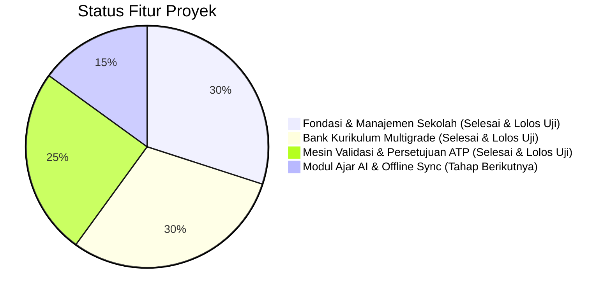

# Status Implementasi: Multigrade Cerdas AI
## SDN SEDAENG II Tosari

Dokumen ini melacak status kemajuan pengembangan secara transparan, akurat, dan terverifikasi. Tidak ada fitur yang dinyatakan selesai sebelum lolos uji kompilasi dan pengujian fungsional.

---

## 1. Ringkasan Status Fitur

---

## 2. Rincian Status Komponen

### A. Fondasi & Manajemen Sekolah (Tahap 1 - Selesai & Terverifikasi)
| Komponen / Fitur | Lokasi Berkas | Status Pengujian | Keterangan |
|---|---|---|---|
| **Autentikasi & Keamanan Sesi** | [src/lib/auth/session.ts](file:///c:/Users/UseR/Videos/Antigravity%20Project/MULTIGRADE%20CERDAS/src/lib/auth/session.ts), [src/app/actions/auth.ts](file:///c:/Users/UseR/Videos/Antigravity%20Project/MULTIGRADE%20CERDAS/src/app/actions/auth.ts), [src/app/login/page.tsx](file:///c:/Users/UseR/Videos/Antigravity%20Project/MULTIGRADE%20CERDAS/src/app/login/page.tsx) | **Verified (Unit & Integration Pass)** | Login, logout, hashing bcrypt, token sesi di database PostgreSQL, HTTP-only secure cookie, auto-lock timeout. |
| **Role-Based Access Control (RBAC)** | [src/lib/auth/session.ts](file:///c:/Users/UseR/Videos/Antigravity%20Project/MULTIGRADE%20CERDAS/src/lib/auth/session.ts) (`requireAuth`) | **Verified** | Pembatasan hak akses Administrator, Kepala Sekolah, dan Guru Pengampu divalidasi langsung di sisi server. |
| **Profil SDN SEDAENG II Tosari** | [src/app/dashboard/profil-sekolah/page.tsx](file:///c:/Users/UseR/Videos/Antigravity%20Project/MULTIGRADE%20CERDAS/src/app/dashboard/profil-sekolah/page.tsx), [src/app/actions/school.ts](file:///c:/Users/UseR/Videos/Antigravity%20Project/MULTIGRADE%20CERDAS/src/app/actions/school.ts) | **Verified** | Tampilan & formulir pengubahan profil sekolah (NPSN 20519000, alamat Tosari, Kepala Sekolah, kontak, TA & semester aktif). |
| **Tahun Ajaran & Semester** | [src/app/dashboard/pengaturan-semester/page.tsx](file:///c:/Users/UseR/Videos/Antigravity%20Project/MULTIGRADE%20CERDAS/src/app/dashboard/pengaturan-semester/page.tsx) | **Verified** | Pengelolaan periode akademik aktif, aktivasi semester ganjil/genap, dan sinkronisasi ke profil sekolah. |
| **3 Kelompok Pembelajaran Multigrade** | [src/app/dashboard/kelompok/page.tsx](file:///c:/Users/UseR/Videos/Antigravity%20Project/MULTIGRADE%20CERDAS/src/app/dashboard/kelompok/page.tsx), [src/lib/multigrade.ts](file:///c:/Users/UseR/Videos/Antigravity%20Project/MULTIGRADE%20CERDAS/src/lib/multigrade.ts) | **Verified** | Kelompok A (Kls 1-2 &bull; Fase A), Kelompok B (Kls 3-4 &bull; Fase B), Kelompok C (Kls 5-6 &bull; Fase C). |
| **Data Kelas 1 sampai 6** | `src/db/schema.ts`, `src/db/seed.ts` | **Verified** | Seluruh 6 tingkatan kelas terpetakan secara ketat dan konsisten ke kelompok multigrade masing-masing. |
| **Data Guru & Pengampu Kelompok** | [src/app/dashboard/guru/page.tsx](file:///c:/Users/UseR/Videos/Antigravity%20Project/MULTIGRADE%20CERDAS/src/app/dashboard/guru/page.tsx), [src/app/actions/users.ts](file:///c:/Users/UseR/Videos/Antigravity%20Project/MULTIGRADE%20CERDAS/src/app/actions/users.ts) | **Verified** | Daftar pendidik, penetapan guru pengampu ke kelompok A, B, C, tambah user baru (Admin), dan toggle aktif/nonaktif. |
| **Data 27 Siswa Sintetis** | [src/app/dashboard/siswa/page.tsx](file:///c:/Users/UseR/Videos/Antigravity%20Project/MULTIGRADE%20CERDAS/src/app/dashboard/siswa/page.tsx), [src/app/actions/students.ts](file:///c:/Users/UseR/Videos/Antigravity%20Project/MULTIGRADE%20CERDAS/src/app/actions/students.ts) | **Verified** | 27 siswa terdaftar lengkap dengan kode anonim (`SDN2-A-01` s/d `SDN2-C-09`), filter kelas asal, filter kelompok, dan tambah siswa. |
| **Relasi Terpadu** | `src/lib/multigrade.ts`, [src/app/dashboard/page.tsx](file:///c:/Users/UseR/Videos/Antigravity%20Project/MULTIGRADE%20CERDAS/src/app/dashboard/page.tsx) | **Verified** | Relasi Guru Pengampu &harr; Kelompok &harr; Kelas Asal &harr; Siswa terikat di server dan tidak dapat inkonsisten. |
| **Log Audit Perubahan Penting** | [src/lib/audit/logger.ts](file:///c:/Users/UseR/Videos/Antigravity%20Project/MULTIGRADE%20CERDAS/src/lib/audit/logger.ts), [src/app/dashboard/audit/page.tsx](file:///c:/Users/UseR/Videos/Antigravity%20Project/MULTIGRADE%20CERDAS/src/app/dashboard/audit/page.tsx) | **Verified** | Setiap tindakan login, mutasi profil, user, semester, dan siswa tercatat otomatis dengan rincian JSON payload. |

---

### B. Modul Bank Kurikulum Multigrade (Selesai & Terverifikasi)
| Komponen / Fitur | Lokasi Berkas | Status Pengujian | Keterangan |
|---|---|---|---|
| **Mata Pelajaran & Fase A, B, C** | `src/db/schema.ts`, `src/db/seed.ts` | **Verified** | 9 mapel SD resmi (B. Indo, MTK, Pancasila, IPAS, PJOK, Seni, B. Inggris, Mulok) terikat pada Fase A (Kls 1-2), Fase B (Kls 3-4), dan Fase C (Kls 5-6). |
| **Dokumen Sumber Kurikulum & Impor Dokumen** | [src/app/dashboard/kurikulum/sumber/page.tsx](file:///c:/Users/UseR/Videos/Antigravity%20Project/MULTIGRADE%20CERDAS/src/app/dashboard/kurikulum/sumber/page.tsx), [src/app/actions/curriculum.ts](file:///c:/Users/UseR/Videos/Antigravity%20Project/MULTIGRADE%20CERDAS/src/app/actions/curriculum.ts) | **Verified** | Parsing PDF (`pdf-parse`), Word DOCX (`mammoth`), Excel XLSX (`xlsx`), dan teks manual. Deteksi metadata, penerbit, nomor regulasi, tahun, dan penandaan evaluasi manual (`needsManualReview`). |
| **Verbatim Capaian Pembelajaran (CP) Resmi** | [src/app/dashboard/kurikulum/cp/page.tsx](file:///c:/Users/UseR/Videos/Antigravity%20Project/MULTIGRADE%20CERDAS/src/app/dashboard/kurikulum/cp/page.tsx), [src/lib/curriculum/extractor.ts](file:///c:/Users/UseR/Videos/Antigravity%20Project/MULTIGRADE%20CERDAS/src/lib/curriculum/extractor.ts) | **Verified** | Rumusan CP resmi disimpan utuh (*verbatim*) sesuai Keputusan Kepala BSKAP No. 032/H/KR/2024. Pemisahan ketat kutipan resmi (`originalSourceText`) vs interpretasi AI (`aiInterpretation`). |
| **Pendeteksian Duplikasi CP (SHA-256)** | [src/lib/curriculum/extractor.ts](file:///c:/Users/UseR/Videos/Antigravity%20Project/MULTIGRADE%20CERDAS/src/lib/curriculum/extractor.ts) | **Verified** | Hash kanonikal SHA-256 memblokir redundansi entri CP kembar pada fase dan elemen yang sama secara instan di server. |
| **Tujuan Pembelajaran (TP) & Elemen** | [src/app/dashboard/kurikulum/tp/page.tsx](file:///c:/Users/UseR/Videos/Antigravity%20Project/MULTIGRADE%20CERDAS/src/app/dashboard/kurikulum/tp/page.tsx) | **Verified** | Dekonstruksi CP menjadi TP terukur dengan identifikasi kompetensi, lingkup materi, target kelas, dan referensi CP induk. |
| **Alur Tujuan Pembelajaran (ATP) Multigrade** | [src/app/dashboard/kurikulum/atp/page.tsx](file:///c:/Users/UseR/Videos/Antigravity%20Project/MULTIGRADE%20CERDAS/src/app/dashboard/kurikulum/atp/page.tsx) | **Verified** | Rencana alur tahunan/semester dengan alokasi Jam Pelajaran (JP), urutan sekuensial TP, dan strategi kelas rangkap (*staggered learning*). |
| **Riwayat Snapshot & Diff Versi** | [src/lib/curriculum/versioning.ts](file:///c:/Users/UseR/Videos/Antigravity%20Project/MULTIGRADE%20CERDAS/src/lib/curriculum/versioning.ts), [src/app/dashboard/kurikulum/versi/page.tsx](file:///c:/Users/UseR/Videos/Antigravity%20Project/MULTIGRADE%20CERDAS/src/app/dashboard/kurikulum/versi/page.tsx) | **Verified** | Setiap perubahan field menyimpan snapshot riwayat JSON dan menyediakan inspeksi diff perubahan antarversi. |
| **Ekspor Data Kurikulum** | [src/app/dashboard/kurikulum/ekspor/page.tsx](file:///c:/Users/UseR/Videos/Antigravity%20Project/MULTIGRADE%20CERDAS/src/app/dashboard/kurikulum/ekspor/page.tsx) | **Verified** | Ekspor format JSON terstruktur lengkap dan format siap cetak (HTML Print View) untuk dokumentasi sekolah. |

---

### C. Mesin Validasi Kurikulum & Siklus Persetujuan (Selesai & Terverifikasi)
| Komponen / Fitur | Lokasi Berkas | Status Pengujian | Keterangan |
|---|---|---|---|
| **Mesin Validasi Terkonfigurasi** | [src/lib/curriculum/validation-engine.ts](file:///c:/Users/UseR/Videos/Antigravity%20Project/MULTIGRADE%20CERDAS/src/lib/curriculum/validation-engine.ts) | **Verified (7/7 tests)** | Memeriksa integritas referensi CP–TP–ATP, TP yatim, ketidakcocokan fase/mapel, urutan ganda, celah urutan bolong, toleransi alokasi JP (&plusmn;20%), dan pemisahan atribusi AI. |
| **Pemeriksaan Prasyarat & Siklus Sirkular** | `src/lib/curriculum/validation-engine.ts` (`detectPrerequisiteCycles`) | **Verified** | Deteksi pelanggaran prasyarat urutan maju dan algoritma DFS pendeteksi siklus melingkar (A &rarr; B &rarr; A). |
| **Penegasan Pedagogis Mutlak** | `src/lib/curriculum/validation-engine.ts` (`PEDAGOGICAL_DISCLAIMER`) | **Verified** | Klausul penafian wajib: validasi otomatis hanya memverifikasi teknis, kelayakan pedagogis tetap wewenang guru dan Kepala Sekolah. |
| **Layar Detail CP** | [src/app/dashboard/kurikulum/cp/[id]/page.tsx](file:///c:/Users/UseR/Videos/Antigravity%20Project/MULTIGRADE%20CERDAS/src/app/dashboard/kurikulum/cp/[id]/page.tsx) | **Verified** | Penampilan kutipan resmi verbatim terpisah dari interpretasi guru/AI, daftar TP turunan, dan riwayat audit. |
| **Layar Editor TP & Prasyarat** | [src/app/dashboard/kurikulum/tp/[id]/page.tsx](file:///c:/Users/UseR/Videos/Antigravity%20Project/MULTIGRADE%20CERDAS/src/app/dashboard/kurikulum/tp/[id]/page.tsx) | **Verified** | Penyesuaian rumusan TP menurut kebutuhan kelas tanpa mengubah CP asli, manajer prasyarat (wajib/dianjurkan), dan deteksi masalah langsung. |
| **Layar Editor Workspace ATP** | [src/app/dashboard/kurikulum/atp/[id]/page.tsx](file:///c:/Users/UseR/Videos/Antigravity%20Project/MULTIGRADE%20CERDAS/src/app/dashboard/kurikulum/atp/[id]/page.tsx) | **Verified** | Diagram alur urutan bernomor, pemindahan urutan naik/turun, telaah alokasi JP per TP, indikator keterpenuhan prasyarat, dan laporan masalah validasi terintegrasi. |
| **Siklus Hidup Status ATP** | [src/app/actions/validation.ts](file:///c:/Users/UseR/Videos/Antigravity%20Project/MULTIGRADE%20CERDAS/src/app/actions/validation.ts) | **Verified** | 5 status lifecycle: `draf` &rarr; `ditinjau` &rarr; `disetujui` &rarr; `digunakan` (aktif pembelajaran), plus `ditolak` (wajib menyertakan catatan penolakan). |
| **Pusat Validasi Kurikulum** | [src/app/dashboard/kurikulum/validasi/page.tsx](file:///c:/Users/UseR/Videos/Antigravity%20Project/MULTIGRADE%20CERDAS/src/app/dashboard/kurikulum/validasi/page.tsx) | **Verified** | Panel audit seluruh masalah validasi (Kritis, Peringatan, Info), penandaan status selesai/diabaikan, tinjauan konfigurasi aturan, dan riwayat laporan. |

---

### D. Fitur yang Belum Dibuat (Agenda Tahap Berikutnya)
1. **Pemetaan Materi Pembelajaran dengan Google AI Studio (Gemini SDK):**
   * Sintesis lembar kerja dan aktivitas dual-track / multi-level per kelompok Fase.
2. **Offline Outbox Sync Engine (IndexedDB & Service Worker):**
   * Pengisian observasi nilai dan jurnal mengajar saat sinyal seluler Tosari drop, lalu sinkronisasi otomatis saat terhubung kembali.
3. **Instrumen Asesmen Formatif & Portofolio Siswa:**
   * Rubrik observasi terpadu per TP untuk 27 siswa SDN Sedaeng II.

---

## 3. Hasil Pengujian Mutu Terakhir
* **Vitest Suite (Unit & Integration Test):** **29 tests PASSED** dari 6 test files (100% green).
  - `tests/auth.test.ts` (4 passed)
  - `tests/users-and-students.test.ts` (4 passed)
  - `tests/school-and-groups.test.ts` (5 passed)
  - `tests/audit-logs.test.ts` (2 passed)
  - `tests/curriculum-bank.test.ts` (7 passed)
  - `tests/curriculum-validation.test.ts` (7 passed)
* **TypeScript Compilation (`tsc --noEmit`):** **0 error** (Strict Mode, 100% type safety).
* **Next.js Production Build (`next build`):** **Sukses** (21 rute App Router terkompilasi, First Load JS bersama 103 kB).
