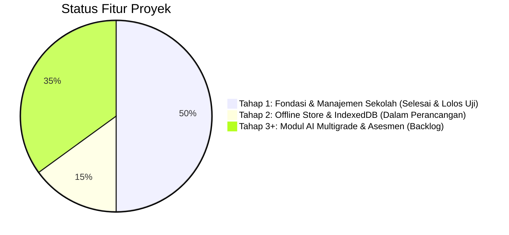

# Status Implementasi: Multigrade Cerdas AI
## SDN SEDAENG II Tosari

Dokumen ini melacak status kemajuan pengembangan secara transparan, akurat, dan terverifikasi. Tidak ada fitur yang dinyatakan selesai sebelum lolos uji kompilasi dan pengujian fungsional.

---

## 1. Ringkasan Status Fitur

---

## 2. Rincian Status Komponen

### A. Fitur & Komponen yang Sudah Selesai & Terverifikasi (Tahap 1)
Komponen pada tabel ini telah selesai diimplementasikan, dimigrasikan ke PostgreSQL, dan lulus seluruh pengujian otomatis (15 unit & integration tests, TypeScript typecheck, dan Next.js production build):

| Komponen / Fitur | Lokasi Berkas | Status Pengujian | Keterangan |
|---|---|---|---|
| **Autentikasi & Keamanan Sesi** | [src/lib/auth/session.ts](file:///c:/Users/UseR/Videos/Antigravity%20Project/MULTIGRADE%20CERDAS/src/lib/auth/session.ts), [src/app/actions/auth.ts](file:///c:/Users/UseR/Videos/Antigravity%20Project/MULTIGRADE%20CERDAS/src/app/actions/auth.ts), [src/app/login/page.tsx](file:///c:/Users/UseR/Videos/Antigravity%20Project/MULTIGRADE%20CERDAS/src/app/login/page.tsx) | **Verified (Unit & Integration Pass)** | Login, logout, hashing bcrypt, token sesi di database PostgreSQL, HTTP-only secure cookie, auto-lock timeout. |
| **Role-Based Access Control (RBAC)** | `src/lib/auth/session.ts` (`requireAuth`) | **Verified** | Pembatasan hak akses Administrator, Kepala Sekolah, dan Guru Pengampu divalidasi langsung di sisi server. |
| **Profil SDN SEDAENG II Tosari** | [src/app/dashboard/profil-sekolah/page.tsx](file:///c:/Users/UseR/Videos/Antigravity%20Project/MULTIGRADE%20CERDAS/src/app/dashboard/profil-sekolah/page.tsx), [src/app/actions/school.ts](file:///c:/Users/UseR/Videos/Antigravity%20Project/MULTIGRADE%20CERDAS/src/app/actions/school.ts) | **Verified** | Tampilan & formulir pengubahan profil sekolah (NPSN 20519000, alamat Tosari, Kepala Sekolah, kontak, TA & semester aktif). |
| **Tahun Ajaran & Semester** | [src/app/dashboard/pengaturan-semester/page.tsx](file:///c:/Users/UseR/Videos/Antigravity%20Project/MULTIGRADE%20CERDAS/src/app/dashboard/pengaturan-semester/page.tsx) | **Verified** | Pengelolaan periode akademik aktif, aktivasi semester ganjil/genap, dan sinkronisasi ke profil sekolah. |
| **3 Kelompok Pembelajaran Multigrade** | [src/app/dashboard/kelompok/page.tsx](file:///c:/Users/UseR/Videos/Antigravity%20Project/MULTIGRADE%20CERDAS/src/app/dashboard/kelompok/page.tsx), [src/lib/multigrade.ts](file:///c:/Users/UseR/Videos/Antigravity%20Project/MULTIGRADE%20CERDAS/src/lib/multigrade.ts) | **Verified** | Kelompok A (Kls 1-2 &bull; Fase A), Kelompok B (Kls 3-4 &bull; Fase B), Kelompok C (Kls 5-6 &bull; Fase C). |
| **Data Kelas 1 sampai 6** | `src/db/schema.ts`, `src/db/seed.ts` | **Verified** | Seluruh 6 tingkatan kelas terpetakan secara ketat dan konsisten ke kelompok multigrade masing-masing. |
| **Data Guru & Pengampu Kelompok** | [src/app/dashboard/guru/page.tsx](file:///c:/Users/UseR/Videos/Antigravity%20Project/MULTIGRADE%20CERDAS/src/app/dashboard/guru/page.tsx), [src/app/actions/users.ts](file:///c:/Users/UseR/Videos/Antigravity%20Project/MULTIGRADE%20CERDAS/src/app/actions/users.ts) | **Verified** | Daftar pendidik, penetapan guru pengampu ke kelompok A, B, C, tambah user baru (Admin), dan toggle aktif/nonaktif. |
| **Data 27 Siswa Sintetis** | [src/app/dashboard/siswa/page.tsx](file:///c:/Users/UseR/Videos/Antigravity%20Project/MULTIGRADE%20CERDAS/src/app/dashboard/siswa/page.tsx), [src/app/actions/students.ts](file:///c:/Users/UseR/Videos/Antigravity%20Project/MULTIGRADE%20CERDAS/src/app/actions/students.ts) | **Verified** | 27 siswa terdaftar lengkap dengan kode anonim (`SDN2-A-01` s/d `SDN2-C-09`), filter kelas asal, filter kelompok, dan tambah siswa. |
| **Relasi Terpadu** | `src/lib/multigrade.ts`, [src/app/dashboard/page.tsx](file:///c:/Users/UseR/Videos/Antigravity%20Project/MULTIGRADE%20CERDAS/src/app/dashboard/page.tsx) | **Verified** | Relasi Guru Pengampu &harr; Kelompok &harr; Kelas Asal &harr; Siswa terikat di server dan tidak dapat inkonsisten. |
| **Log Audit Perubahan Penting** | [src/lib/audit/logger.ts](file:///c:/Users/UseR/Videos/Antigravity%20Project/MULTIGRADE%20CERDAS/src/lib/audit/logger.ts), [src/app/dashboard/audit/page.tsx](file:///c:/Users/UseR/Videos/Antigravity%20Project/MULTIGRADE%20CERDAS/src/app/dashboard/audit/page.tsx) | **Verified** | Setiap tindakan login, mutasi profil, user, semester, dan siswa tercatat otomatis dengan rincian JSON payload. |
| **Dashboard & Navigasi Bahasa Indonesia** | [src/components/Navbar.tsx](file:///c:/Users/UseR/Videos/Antigravity%20Project/MULTIGRADE%20CERDAS/src/components/Navbar.tsx), [src/components/Sidebar.tsx](file:///c:/Users/UseR/Videos/Antigravity%20Project/MULTIGRADE%20CERDAS/src/components/Sidebar.tsx), [src/app/dashboard/page.tsx](file:///c:/Users/UseR/Videos/Antigravity%20Project/MULTIGRADE%20CERDAS/src/app/dashboard/page.tsx) | **Verified** | Antarmuka responsif untuk HP Android dan laptop, drawer mobile, status badge, dan kartu distribusi kelompok. |
| **Basis Data PostgreSQL Sungguhan** | [src/db/index.ts](file:///c:/Users/UseR/Videos/Antigravity%20Project/MULTIGRADE%20CERDAS/src/db/index.ts), `drizzle/` | **Verified** | Drizzle ORM berjalan pada mesin PostgreSQL (PGlite disk-persistent engine `./data/postgres` & postgres connection pool). |
| **Suite Pengujian Otomatis (15 Tests)** | [tests/auth.test.ts](file:///c:/Users/UseR/Videos/Antigravity%20Project/MULTIGRADE%20CERDAS/tests/auth.test.ts), [tests/school-and-groups.test.ts](file:///c:/Users/UseR/Videos/Antigravity%20Project/MULTIGRADE%20CERDAS/tests/school-and-groups.test.ts), [tests/users-and-students.test.ts](file:///c:/Users/UseR/Videos/Antigravity%20Project/MULTIGRADE%20CERDAS/tests/users-and-students.test.ts), [tests/audit-logs.test.ts](file:///c:/Users/UseR/Videos/Antigravity%20Project/MULTIGRADE%20CERDAS/tests/audit-logs.test.ts) | **100% Passed (15/15)** | Menjamin login/logout, peran, relasi kelas-kelompok, Zod validation, penolakan akses tidak sah, dan persistensi data. |

---

### B. Fitur yang Belum Dibuat (Backlog Kurikulum & Offline Tingkat Lanjut)
Sesuai arahan arsitektur, pengerjaan Tahap 1 строго dibatasi pada fondasi dan manajemen sekolah. Fitur di bawah ini merupakan agenda tahap selanjutnya:

1. **Service Worker PWA Caching:**
   * Caching aset statis offline penuh.
2. **Offline Outbox Sync Engine (IndexedDB):**
   * Antrean lokal di peramban saat sinyal seluler Tosari terputus.
3. **Integrasi Google AI Studio (Gemini SDK):**
   * Prompt template diferensiasi modul ajar multigrade (Fase A, B, C).
4. **Penyusun Modul Ajar Multigrade & Grid Asesmen Formatif:**
   * Antarmuka input observasi cepat dan generator modul ajar dual-track.

---

## 3. Hasil Pengujian Mutu Terakhir
* **Vitest Unit & Integration Test:** 15 test lulus dari 4 test file (0 fail).
* **TypeScript Compilation (`tsc --noEmit`):** 0 error.
* **Production Build (`next build`):** Sukses, 12 rute terkompilasi dan siap saji.
