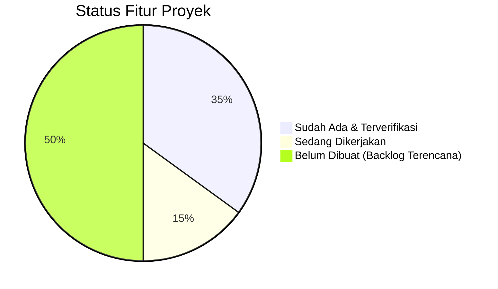

# Status Implementasi: Multigrade Cerdas AI
## SDN SEDAENG II Tosari

Dokumen ini melacak status kemajuan pengembangan secara transparan, akurat, dan terverifikasi. Tidak ada fitur yang dinyatakan selesai sebelum lolos uji kompilasi dan pengujian fungsional.

---

## 1. Ringkasan Status Fitur

---

## 2. Rincian Status Komponen

### A. Fitur & Komponen yang Sudah Ada (Implemented & Verified)
Komponen pada tabel ini telah selesai dikonfigurasi, ditulis kodenya, dan diverifikasi berhasil melalui uji kompilasi (`npx tsc --noEmit`) dan build produksi (`next build`):

| Komponen / Fitur | Lokasi Berkas | Status Verifikasi | Keterangan |
|---|---|---|---|
| **Git Repository** | `.git/` | **Verified** | Repositori lokal berhasil diinisialisasi sebagai sumber kontrol versi utama. |
| **Scaffold Next.js 15 & React 19** | `package.json`, `next.config.mjs` | **Verified (Build Pass)** | Konfigurasi App Router dengan dukungan penuh SSR, Server Actions, dan bundling modern. |
| **TypeScript Strict Mode** | `tsconfig.json` | **Verified (Zero Error)** | Pengecekan tipe statis ketat tanpa celah `any` tak terkontrol. |
| **Tailwind CSS Desain Sistem** | `tailwind.config.ts`, `postcss.config.mjs`, `src/app/globals.css` | **Verified** | Styling berbasis utilitas ringan untuk performa optimal di perangkat laptop sekolah. |
| **Skema Basis Data Drizzle ORM** | [src/db/schema.ts](file:///c:/Users/UseR/Videos/Antigravity%20Project/MULTIGRADE%20CERDAS/src/db/schema.ts) | **Verified (Type Checked)** | Skema lengkap mencakup 10 tabel: `users`, `multigrade_groups`, `classes`, `students`, `subjects`, `learning_objectives`, `multigrade_lesson_plans`, `assessments`, `student_assessment_results`, dan `offline_sync_logs`. |
| **Klien Database PostgreSQL** | [src/db/index.ts](file:///c:/Users/UseR/Videos/Antigravity%20Project/MULTIGRADE%20CERDAS/src/db/index.ts), `drizzle.config.ts` | **Verified** | Inisialisasi pool koneksi dengan `postgres.js` dan konfigurasi Drizzle Kit. |
| **Validasi Skema Zod** | [src/lib/validations/index.ts](file:///c:/Users/UseR/Videos/Antigravity%20Project/MULTIGRADE%20CERDAS/src/lib/validations/index.ts) | **Verified** | Validasi integritas data siswa (zero-PII), RPP multigrade, asesmen, dan payload sinkronisasi. |
| **Halaman Kesiapan Operasional** | [src/app/page.tsx](file:///c:/Users/UseR/Videos/Antigravity%20Project/MULTIGRADE%20CERDAS/src/app/page.tsx), [src/app/layout.tsx](file:///c:/Users/UseR/Videos/Antigravity%20Project/MULTIGRADE%20CERDAS/src/app/layout.tsx) | **Verified (Prerendered)** | Tampilan beranda informatif menampilkan konteks 27 siswa dan kelompok A, B, C SDN SEDAENG II. |
| **Dokumentasi Arsitektur Lengkap** | `PROJECT_PLAN.md`, `ARCHITECTURE.md`, `DATABASE_DESIGN.md`, `SECURITY_PLAN.md`, `IMPLEMENTATION_STATUS.md` | **Verified** | 5 dokumen panduan arsitektural dan operasional lengkap. |

---

### B. Fitur yang Sedang Dikerjakan (In Progress / Scaffolded)
Komponen yang rancangannya telah disiapkan pada tahap arsitektur dan sedang dalam proses perakitan:

| Komponen / Fitur | Lokasi Rencana | Target Penyelesaian | Catatan Penting |
|---|---|---|---|
| **Penyusunan Seed Referensi Resmi** | `src/db/seed.ts` | Tahap 3 | Hanya mata pelajaran resmi SD dan struktur 3 kelompok (A, B, C). **Tidak menyertakan data siswa asli atau CP fiktif.** |
| **Rancangan Engine IndexedDB Lokal** | `src/lib/offline/client-store.ts` | Tahap 4 | Lapisan penyimpanan lokal di browser untuk menampung input saat internet Tosari padam. |

---

### C. Fitur yang Belum Dibuat (Planned / Backlog)
Fitur-fitur ini **belum diimplementasikan** dan menunggu penyelesaian bertahap sesuai rencana kerja:

1. **Service Worker & PWA Caching:**
   * Registrasi service worker untuk menyimpan aset statis (HTML/CSS/JS) agar aplikasi dapat dibuka saat koneksi internet sekolah benar-benar terputus.
2. **Integrasi Google AI Studio (Gemini SDK):**
   * Modul server di `src/lib/ai/gemini-client.ts` untuk memanggil Gemini API.
   * Template prompt diferensiasi pembelajaran kelas rangkap (Fase A, B, C).
   * Filter sanitasi data sebelum prompt dikirim.
3. **Antarmuka Pengguna Guru (Teacher Dashboard):**
   * Dashboard Kelompok A (Kelas 1 & 2): Alur instruksi visual & lembar kerja mandiri.
   * Dashboard Kelompok B (Kelas 3 & 4): Alur integrasi IPAS & latihan bertingkat.
   * Dashboard Kelompok C (Kelas 5 & 6): Alur proyek P5 & panduan tutor sebaya.
4. **Penyusun Modul Ajar Multigrade (*Lesson Plan Builder*):**
   * Generator modul ajar dengan alokasi waktu simultan (misal 70 menit: 35 menit bimbingan langsung kelas 1 / 35 menit kelas 2).
5. **Grid Asesmen Formatif Cepat (*Rapid Formative Assessment Grid*):**
   * Matriks input observasi 27 siswa secara cepat dengan 4 skala capaian (*perlu bimbingan*, *cukup*, *baik*, *sangat baik*).
6. **Autentikasi Guru & Manajemen Sesi Sederhana:**
   * Sistem login aman dengan auto-lock untuk perangkat bersama di ruang guru SDN SEDAENG II.
7. **Pengujian End-to-End (E2E) Siklus Offline-Online:**
   * Pengujian simulasi pemutusan jaringan dan verifikasi pengiriman antrean outbox saat internet kembali tersambung.

---

## 3. Catatan Kepatuhan Regulasi & Integritas Proyek
* [x] **Zero Fake CP:** Tidak ada pembuatan Capaian Pembelajaran palsu/fiktif dalam kode maupun database. Impor CP wajib menggunakan dokumen sah BSKAP Kemendikbudristek No. 032/H/KR/2024.
* [x] **Zero Real Student PII:** Tidak ada data identitas asli 27 siswa SDN SEDAENG II Tosari yang dimasukkan ke dalam kode atau repositori publik.
* [x] **Verified Compilation:** Seluruh kode yang telah dibuat lolos uji `tsc --noEmit` dan `next build` secara sukses.
