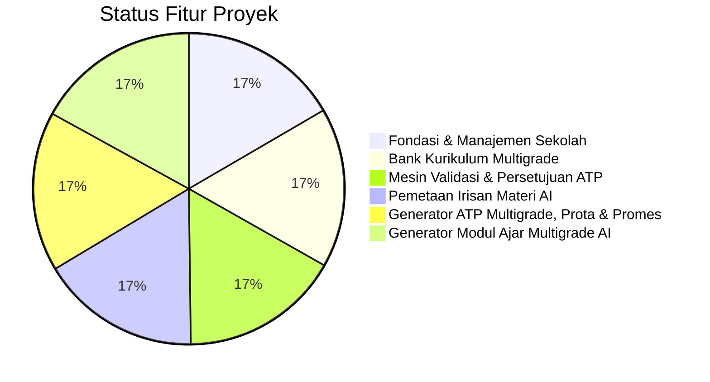

# Status Implementasi: Multigrade Cerdas AI
## SDN SEDAENG II Tosari

Dokumen ini melacak status kemajuan pengembangan secara transparan, akurat, dan terverifikasi. Tidak ada fitur yang dinyatakan selesai sebelum lolos uji kompilasi dan pengujian fungsional.

---

## 1. Ringkasan Status Fitur

---

## 2. Rincian Status Komponen

### A. Fondasi & Manajemen Sekolah (Tahap 1 - Selesai & Terverifikasi)
| Komponen / Fitur | Lokasi Berkas | Status Pengujian | Keterangan |
|---|---|---|---|
| **Autentikasi & Keamanan Sesi** | [src/lib/auth/session.ts](file:///c:/Users/UseR/Videos/Antigravity%20Project/MULTIGRADE%20CERDAS/src/lib/auth/session.ts), [src/app/actions/auth.ts](file:///c:/Users/UseR/Videos/Antigravity%20Project/MULTIGRADE%20CERDAS/src/app/actions/auth.ts), [src/app/login/page.tsx](file:///c:/Users/UseR/Videos/Antigravity%20Project/MULTIGRADE%20CERDAS/src/app/login/page.tsx) | **Verified (Unit & Integration Pass)** | Login, logout, hashing bcrypt, token sesi di database PostgreSQL, HTTP-only secure cookie, auto-lock timeout. |
| **Role-Based Access Control (RBAC)** | [src/lib/auth/session.ts](file:///c:/Users/UseR/Videos/Antigravity%20Project/MULTIGRADE%20CERDAS/src/lib/auth/session.ts) (`requireAuth`) | **Verified** | Pembatasan hak akses Administrator, Kepala Sekolah, dan Guru Pengampu divalidasi langsung di sisi server. |
| **Profil SDN SEDAENG II Tosari** | [src/app/dashboard/profil-sekolah/page.tsx](file:///c:/Users/UseR/Videos/Antigravity%20Project/MULTIGRADE%20CERDAS/src/app/dashboard/profil-sekolah/page.tsx), [src/app/actions/school.ts](file:///c:/Users/UseR/Videos/Antigravity%20Project/MULTIGRADE%20CERDAS/src/app/actions/school.ts) | **Verified** | Tampilan & formulir pengubahan profil sekolah (NPSN 20519070, alamat Tosari, Kepala Sekolah, kontak, TA & semester aktif). |
| **Tahun Ajaran & Semester** | [src/app/dashboard/pengaturan-semester/page.tsx](file:///c:/Users/UseR/Videos/Antigravity%20Project/MULTIGRADE%20CERDAS/src/app/dashboard/pengaturan-semester/page.tsx) | **Verified** | Pengelolaan periode akademik aktif, aktivasi semester ganjil/genap, dan sinkronisasi ke profil sekolah. |
| **3 Kelompok Pembelajaran Multigrade** | [src/app/dashboard/kelompok/page.tsx](file:///c:/Users/UseR/Videos/Antigravity%20Project/MULTIGRADE%20CERDAS/src/app/dashboard/kelompok/page.tsx), [src/lib/multigrade.ts](file:///c:/Users/UseR/Videos/Antigravity%20Project/MULTIGRADE%20CERDAS/src/lib/multigrade.ts) | **Verified** | Kelompok A (Kls 1-2 &bull; Fase A), Kelompok B (Kls 3-4 &bull; Fase B), Kelompok C (Kls 5-6 &bull; Fase C). |
| **Data Kelas 1 sampai 6** | `src/db/schema.ts`, `src/db/seed.ts` | **Verified** | Seluruh 6 tingkatan kelas terpetakan secara ketat dan konsisten ke kelompok multigrade masing-masing. |
| **Data Guru & Pengampu Kelompok** | [src/app/dashboard/guru/page.tsx](file:///c:/Users/UseR/Videos/Antigravity%20Project/MULTIGRADE%20CERDAS/src/app/dashboard/guru/page.tsx), [src/app/actions/users.ts](file:///c:/Users/UseR/Videos/Antigravity%20Project/MULTIGRADE%20CERDAS/src/app/actions/users.ts) | **Verified** | Daftar pendidik, penetapan guru pengampu ke kelompok A, B, C, tambah user baru (Admin), dan toggle aktif/nonaktif. |
| **Data 27 Siswa Sintetis** | [src/app/dashboard/siswa/page.tsx](file:///c:/Users/UseR/Videos/Antigravity%20Project/MULTIGRADE%20CERDAS/src/app/dashboard/siswa/page.tsx), [src/app/actions/students.ts](file:///c:/Users/UseR/Videos/Antigravity%20Project/MULTIGRADE%20CERDAS/src/app/actions/students.ts) | **Verified** | 27 siswa terdaftar lengkap dengan kode anonim (`SDN2-A-01` s/d `SDN2-C-09`), filter kelas asal, filter kelompok, dan tambah siswa. |
| **Relasi Terpadu** | `src/lib/multigrade.ts`, [src/app/dashboard/page.tsx](file:///c:/Users/UseR/Videos/Antigravity%20Project/MULTIGRADE%20CERDAS/src/app/dashboard/page.tsx) | **Verified** | Relasi Guru Pengampu &harr; Kelompok &harr; Kelas Asal &harr; Siswa terikat di server dan tidak dapat inkonsisten. |
| **Log Audit Perubahan Penting** | [src/lib/audit/logger.ts](file:///c:/Users/UseR/Videos/Antigravity%20Project/MULTIGRADE%20CERDAS/src/lib/audit/logger.ts), [src/app/dashboard/audit/page.tsx](file:///c:/Users/UseR/Videos/Antigravity%20Project/MULTIGRADE%20CERDAS/src/app/dashboard/audit/page.tsx) | **Verified** | Setiap tindakan login, mutasi profil, user, semester, dan siswa tercatat otomatis dengan rincian JSON payload. |

---

### B. Modul Bank Kurikulum Multigrade (Selesai & Terverifikasi)
| Komponen / Fitur | Lokasi Berkas | Status Pengujian | Keterangan |
|---|---|---|---|
| **Mata Pelajaran & Fase A, B, C** | `src/db/schema.ts`, `src/db/seed.ts` | **Verified** | 9 mapel SD resmi (B. Indo, MTK, Pancasila, IPAS, PJOK, Seni, B. Inggris, Mulok) terikat pada Fase A (Kls 1-2), Fase B (Kls 3-4), dan Fase C (Kls 5-6). |
| **Dokumen Sumber Kurikulum & Impor Dokumen** | [src/app/dashboard/kurikulum/sumber/page.tsx](file:///c:/Users/UseR/Videos/Antigravity%20Project/MULTIGRADE%20CERDAS/src/app/dashboard/kurikulum/sumber/page.tsx), [src/app/actions/curriculum.ts](file:///c:/Users/UseR/Videos/Antigravity%20Project/MULTIGRADE%20CERDAS/src/app/actions/curriculum.ts) | **Verified** | Parsing PDF (`pdf-parse`), Word DOCX (`mammoth`), Excel XLSX (`xlsx`), dan teks manual. Deteksi metadata, penerbit, nomor regulasi, tahun, dan penandaan evaluasi manual (`needsManualReview`). |
| **Verbatim Capaian Pembelajaran (CP) Resmi** | [src/app/dashboard/kurikulum/cp/page.tsx](file:///c:/Users/UseR/Videos/Antigravity%20Project/MULTIGRADE%20CERDAS/src/app/dashboard/kurikulum/cp/page.tsx), [src/lib/curriculum/extractor.ts](file:///c:/Users/UseR/Videos/Antigravity%20Project/MULTIGRADE%20CERDAS/src/lib/curriculum/extractor.ts) | **Verified** | Rumusan CP resmi disimpan utuh (*verbatim*) sesuai Keputusan Kepala BSKAP No. 032/H/KR/2024. Pemisahan ketat kutipan resmi (`originalSourceText`) vs interpretasi AI (`aiInterpretation`). |
| **Pendeteksian Duplikasi CP (SHA-256)** | [src/lib/curriculum/extractor.ts](file:///c:/Users/UseR/Videos/Antigravity%20Project/MULTIGRADE%20CERDAS/src/lib/curriculum/extractor.ts) | **Verified** | Hash kanonikal SHA-256 memblokir redundansi entri CP kembar pada fase dan elemen yang sama secara instan di server. |
| **Tujuan Pembelajaran (TP) & Elemen** | [src/app/dashboard/kurikulum/tp/page.tsx](file:///c:/Users/UseR/Videos/Antigravity%20Project/MULTIGRADE%20CERDAS/src/app/dashboard/kurikulum/tp/page.tsx) | **Verified** | Dekonstruksi CP menjadi TP terukur dengan identifikasi kompetensi, lingkup materi, target kelas, dan referensi CP induk. |
| **Alur Tujuan Pembelajaran (ATP) Multigrade** | [src/app/dashboard/kurikulum/atp/page.tsx](file:///c:/Users/UseR/Videos/Antigravity%20Project/MULTIGRADE%20CERDAS/src/app/dashboard/kurikulum/atp/page.tsx) | **Verified** | Rencana alur tahunan/semester dengan alokasi Jam Pelajaran (JP), urutan sekuensial TP, dan strategi kelas rangkap (*staggered learning*). |
| **Riwayat Snapshot & Diff Versi** | [src/lib/curriculum/versioning.ts](file:///c:/Users/UseR/Videos/Antigravity%20Project/MULTIGRADE%20CERDAS/src/lib/curriculum/versioning.ts), [src/app/dashboard/kurikulum/versi/page.tsx](file:///c:/Users/UseR/Videos/Antigravity%20Project/MULTIGRADE%20CERDAS/src/app/dashboard/kurikulum/versi/page.tsx) | **Verified** | Setiap perubahan field menyimpan snapshot riwayat JSON dan menyediakan inspeksi diff perubahan antarversi. |
| **Ekspor Data Kurikulum** | [src/app/dashboard/kurikulum/ekspor/page.tsx](file:///c:/Users/UseR/Videos/Antigravity%20Project/MULTIGRADE%20CERDAS/src/app/dashboard/kurikulum/ekspor/page.tsx) | **Verified** | Ekspor format JSON terstruktur lengkap dan format siap cetak (HTML Print View) untuk dokumentasi sekolah. |

---

### C. Mesin Validasi Kurikulum & Siklus Persetujuan (Selesai & Terverifikasi)
| Komponen / Fitur | Lokasi Berkas | Status Pengujian | Keterangan |
|---|---|---|---|
| **Mesin Validasi Terkonfigurasi** | [src/lib/curriculum/validation-engine.ts](file:///c:/Users/UseR/Videos/Antigravity%20Project/MULTIGRADE%20CERDAS/src/lib/curriculum/validation-engine.ts) | **Verified (7/7 tests)** | Memeriksa integritas referensi CP–TP–ATP, TP yatim, ketidakcocokan fase/mapel, urutan ganda, celah urutan bolong, toleransi alokasi JP (&plusmn;20%), dan pemisahan atribusi AI. |
| **Pemeriksaan Prasyarat & Siklus Sirkular** | `src/lib/curriculum/validation-engine.ts` (`detectPrerequisiteCycles`) | **Verified** | Deteksi pelanggaran prasyarat urutan maju dan algoritma DFS pendeteksi siklus melingkar (A &rarr; B &rarr; A). |
| **Penegasan Pedagogis Mutlak** | `src/lib/curriculum/validation-engine.ts` (`PEDAGOGICAL_DISCLAIMER`) | **Verified** | Klausul penafian wajib: validasi otomatis hanya memverifikasi teknis, kelayakan pedagogis tetap wewenang guru dan Kepala Sekolah. |
| **Layar Detail CP** | [src/app/dashboard/kurikulum/cp/[id]/page.tsx](file:///c:/Users/UseR/Videos/Antigravity%20Project/MULTIGRADE%20CERDAS/src/app/dashboard/kurikulum/cp/[id]/page.tsx) | **Verified** | Penampilan kutipan resmi verbatim terpisah dari interpretasi guru/AI, daftar TP turunan, dan riwayat audit. |
| **Layar Editor TP & Prasyarat** | [src/app/dashboard/kurikulum/tp/[id]/page.tsx](file:///c:/Users/UseR/Videos/Antigravity%20Project/MULTIGRADE%20CERDAS/src/app/dashboard/kurikulum/tp/[id]/page.tsx) | **Verified** | Penyesuaian rumusan TP menurut kebutuhan kelas tanpa mengubah CP asli, manajer prasyarat (wajib/dianjurkan), dan deteksi masalah langsung. |
| **Layar Editor Workspace ATP** | [src/app/dashboard/kurikulum/atp/[id]/page.tsx](file:///c:/Users/UseR/Videos/Antigravity%20Project/MULTIGRADE%20CERDAS/src/app/dashboard/kurikulum/atp/[id]/page.tsx) | **Verified** | Diagram alur urutan bernomor, pemindahan urutan naik/turun, telaah alokasi JP per TP, indikator keterpenuhan prasyarat, dan laporan masalah validasi terintegrasi. |
| **Siklus Hidup Status ATP** | [src/app/actions/validation.ts](file:///c:/Users/UseR/Videos/Antigravity%20Project/MULTIGRADE%20CERDAS/src/app/actions/validation.ts) | **Verified** | 5 status lifecycle: `draf` &rarr; `ditinjau` &rarr; `disetujui` &rarr; `digunakan` (aktif pembelajaran), plus `ditolak` (wajib menyertakan catatan penolakan). |
| **Pusat Validasi Kurikulum** | [src/app/dashboard/kurikulum/validasi/page.tsx](file:///c:/Users/UseR/Videos/Antigravity%20Project/MULTIGRADE%20CERDAS/src/app/dashboard/kurikulum/validasi/page.tsx) | **Verified** | Panel audit seluruh masalah validasi (Kritis, Peringatan, Info), penandaan status selesai/diabaikan, tinjauan konfigurasi aturan, dan riwayat laporan. |

---

### D. Pemetaan Irisan Materi Multigrade AI (Tahap 4 - Selesai & Terverifikasi)
| Komponen / Fitur | Lokasi Berkas | Status Pengujian | Keterangan |
|---|---|---|---|
| **Arsitektur Provider AI Fleksibel (Adapter Pattern)** | [src/lib/ai/provider-interface.ts](file:///c:/Users/UseR/Videos/Antigravity%20Project/MULTIGRADE%20CERDAS/src/lib/ai/provider-interface.ts), [src/lib/ai/provider-factory.ts](file:///c:/Users/UseR/Videos/Antigravity%20Project/MULTIGRADE%20CERDAS/src/lib/ai/provider-factory.ts) | **Verified** | Dukungan multi-engine: Google Gemini 3.8 Flash (`@google/genai`) dan Mesin Heuristik Lokal Tosari (`MockLocalProvider`). Kunci API tersimpan di server-side. |
| **Aturan Multigrade: Larangan Penggabungan Paksa** | [src/lib/ai/providers/mock-local-provider.ts](file:///c:/Users/UseR/Videos/Antigravity%20Project/MULTIGRADE%20CERDAS/src/lib/ai/providers/mock-local-provider.ts), [src/lib/ai/providers/gemini-provider.ts](file:///c:/Users/UseR/Videos/Antigravity%20Project/MULTIGRADE%20CERDAS/src/lib/ai/providers/gemini-provider.ts) | **Verified** | Jika kompetensi berbeda jauh atau tidak cocok digabung, sistem otomatis merekomendasikan `terpisah_paralel` (rotasi kelas rangkap berjenjang) dan TIDAK memaksakan merger. |
| **Pengamanan Anti-Halusinasi & Zero PII** | [src/app/actions/material-intersection.ts](file:///c:/Users/UseR/Videos/Antigravity%20Project/MULTIGRADE%20CERDAS/src/app/actions/material-intersection.ts) | **Verified** | Verifikasi ID sumber ke database resmi, penolakan ID fiktif, pembersihan teks kondisi siswa dari NIK, HP, atau email pribadi. CP resmi tetap verbatim tanpa perubahan. |
| **Output Terstruktur Zod (Tema, TP, Rotasi, Diferensiasi, Asesmen)** | [src/lib/ai/types.ts](file:///c:/Users/UseR/Videos/Antigravity%20Project/MULTIGRADE%20CERDAS/src/lib/ai/types.ts) | **Verified** | Skema ketat: tema bersama, komparasi berdampingan, TP terpadu vs terpisah, alur 4 fase rotasi (pembuka, bimbingan langsung, mandiri, penutup), diferensiasi (konten, proses, produk), dan disclaimer keyakinan AI. |
| **Pelacakan Biaya & Log Penggunaan AI** | `src/db/schema.ts` (`ai_usage_logs`) | **Verified** | Pencatatan prompt tokens, completion tokens, total tokens, estimasi biaya USD, latensi (ms), dan status fallback. |
| **Layar Daftar Pemetaan Irisan** | [src/app/dashboard/kurikulum/irisan-materi/page.tsx](file:///c:/Users/UseR/Videos/Antigravity%20Project/MULTIGRADE%20CERDAS/src/app/dashboard/kurikulum/irisan-materi/page.tsx) | **Verified** | Kartu ringkasan strategi (`terpadu_sebagian`, `terpisah_paralel`, `terpadu_penuh`), indikator keyakinan, badge status, dan filter kelompok/mapel. |
| **Layar Wizard Generator & Mode Manual** | [src/app/dashboard/kurikulum/irisan-materi/baru/page.tsx](file:///c:/Users/UseR/Videos/Antigravity%20Project/MULTIGRADE%20CERDAS/src/app/dashboard/kurikulum/irisan-materi/baru/page.tsx), [src/components/curriculum/MaterialIntersectionWizard.tsx](file:///c:/Users/UseR/Videos/Antigravity%20Project/MULTIGRADE%20CERDAS/src/components/curriculum/MaterialIntersectionWizard.tsx) | **Verified** | Pemilihan kelompok, mapel, TP berdampingan interaktif, peringatan PII real-time, pilihan engine AI, serta fallback mode manual total saat offline. |
| **Layar Detail & Pengelolaan Alur Pembelajaran** | [src/app/dashboard/kurikulum/irisan-materi/[id]/page.tsx](file:///c:/Users/UseR/Videos/Antigravity%20Project/MULTIGRADE%20CERDAS/src/app/dashboard/kurikulum/irisan-materi/[id]/page.tsx), [src/components/curriculum/MaterialIntersectionDetailView.tsx](file:///c:/Users/UseR/Videos/Antigravity%20Project/MULTIGRADE%20CERDAS/src/components/curriculum/MaterialIntersectionDetailView.tsx) | **Verified** | Tampilan komparasi berdampingan, rincian aktivitas rotasi kelas rangkap, diferensiasi konten/proses/produk, rubrik asesmen, pengeditan guru, persetujuan Kepala Sekolah, dan cetak panduan. |

---

### E. Generator ATP Multigrade, Prota & Promes (Tahap 5 - Selesai & Terverifikasi)
| Komponen / Fitur | Lokasi Berkas | Status Pengujian | Keterangan |
|---|---|---|---|
| **Mesin Generator ATP Multigrade** | [src/lib/curriculum/atp-generator.ts](file:///c:/Users/UseR/Videos/Antigravity%20Project/MULTIGRADE%20CERDAS/src/lib/curriculum/atp-generator.ts) | **Verified (8/8 tests)** | Menghasilkan alur pembelajaran sinkron kelas rangkap (Kelompok A: Kls 1-2, B: Kls 3-4, C: Kls 5-6), alur per fase, dan alur kelas mandiri. Mematuhi invarian pedagogis: TP kelas bawah dan atas TIDAK pernah digabungkan secara paksa hanya karena satu fase. |
| **Program Tahunan (Prota) & Program Semester (Promes)** | `src/lib/curriculum/atp-generator.ts`, [src/components/curriculum/AtpPlanDetailView.tsx](file:///c:/Users/UseR/Videos/Antigravity%20Project/MULTIGRADE%20CERDAS/src/components/curriculum/AtpPlanDetailView.tsx) | **Verified** | Matriks resmi 18 pekan efektif per semester (Juli-Desember & Januari-Juni), deteksi pekan asesmen (STS di Mg-9, SAS di Mg-18), dan pembagian alokasi JP mingguan. |
| **Peta Cakupan TP (Coverage Map)** | [src/components/curriculum/AtpGeneratorWizard.tsx](file:///c:/Users/UseR/Videos/Antigravity%20Project/MULTIGRADE%20CERDAS/src/components/curriculum/AtpGeneratorWizard.tsx), [src/components/curriculum/AtpPlanDetailView.tsx](file:///c:/Users/UseR/Videos/Antigravity%20Project/MULTIGRADE%20CERDAS/src/components/curriculum/AtpPlanDetailView.tsx) | **Verified** | Audit visual butir TP terjadwal vs belum terjadwal (*unscheduled*) di fase terkait, tombol penambahan cepat ke alur, serta peringatan tegas jika ada TP draf belum diverifikasi. |
| **Audit Alokasi Waktu (Time Budget Audit)** | [src/lib/curriculum/atp-generator.ts](file:///c:/Users/UseR/Videos/Antigravity%20Project/MULTIGRADE%20CERDAS/src/lib/curriculum/atp-generator.ts) | **Verified** | Komparasi total JP terpasang terhadap standar struktur Kurikulum Merdeka SD (B. Indonesia: 216 JP, Matematika: 144 JP, IPAS: 180 JP, dll.), status sesuai, kurang, atau berlebih. |
| **Server Actions ATP Generator & Versi** | [src/app/actions/atp-generator.ts](file:///c:/Users/UseR/Videos/Antigravity%20Project/MULTIGRADE%20CERDAS/src/app/actions/atp-generator.ts) | **Verified** | `previewAtpGenerationAction`, `saveGeneratedAtpPlanAction`, `updateAtpPlanItemsAction`, dan `getAtpPlanFullDetailsAction` dengan audit logs & pencatatan versi bertahap. |
| **Layar Wizard Generator ATP Cerdas** | [src/app/dashboard/kurikulum/atp/generator/page.tsx](file:///c:/Users/UseR/Videos/Antigravity%20Project/MULTIGRADE%20CERDAS/src/app/dashboard/kurikulum/atp/generator/page.tsx), [src/components/curriculum/AtpGeneratorWizard.tsx](file:///c:/Users/UseR/Videos/Antigravity%20Project/MULTIGRADE%20CERDAS/src/components/curriculum/AtpGeneratorWizard.tsx) | **Verified** | Wizard interaktif pemilihan kelompok, mapel, semester, alokasi jam, tinjauan 6 tab, penggeseran butir alur, dan penyimpanan draf. |
| **Layar Workspace Detail, Prota/Promes & Cetak** | [src/app/dashboard/kurikulum/atp/[id]/page.tsx](file:///c:/Users/UseR/Videos/Antigravity%20Project/MULTIGRADE%20CERDAS/src/app/dashboard/kurikulum/atp/%5Bid%5D/page.tsx), [src/components/curriculum/AtpPlanDetailView.tsx](file:///c:/Users/UseR/Videos/Antigravity%20Project/MULTIGRADE%20CERDAS/src/components/curriculum/AtpPlanDetailView.tsx) | **Verified** | Antarmuka responsif HP & laptop dengan 7 tab (Alur Multigrade Master, Kls Bawah, Kls Atas, Prota, Promes 18 pekan, Cakupan TP, dan Format Cetak Resmi ber-kop SDN Sedaeng II Tosari). |
| **Layar Indeks Alur Tujuan Pembelajaran** | [src/app/dashboard/kurikulum/atp/page.tsx](file:///c:/Users/UseR/Videos/Antigravity%20Project/MULTIGRADE%20CERDAS/src/app/dashboard/kurikulum/atp/page.tsx) | **Verified** | Hero banner bergradien dengan tombol aksi generator, filter tab per kelompok (Semua, Kelompok A, B, C, Kelas Mandiri), dan kartu status komprehensif. |

---

### F. Generator Modul Ajar Multigrade Cerdas AI (Tahap 6 - Selesai & Terverifikasi)
| Komponen / Fitur | Lokasi Berkas | Status Pengujian | Keterangan |
|---|---|---|---|
| **Pola Rotasi 8-Langkah (*Staggered Direct Instruction*)** | [src/lib/modul-ajar/types.ts](file:///c:/Users/UseR/Videos/Antigravity%20Project/MULTIGRADE%20CERDAS/src/lib/modul-ajar/types.ts), [src/lib/modul-ajar/generator.ts](file:///c:/Users/UseR/Videos/Antigravity%20Project/MULTIGRADE%20CERDAS/src/lib/modul-ajar/generator.ts) | **Verified (12/12 tests)** | Menerapkan 8 langkah pembelajaran mutlak: Pembukaan bersama &rarr; Pengantar/demonstrasi bersama &rarr; Bimbingan langsung kelas pertama (kelas kedua tugas terarah) &rarr; Tugas mandiri kelas pertama &rarr; Bimbingan langsung kelas kedua &rarr; Aktivitas & produk kelas masing-masing &rarr; Berbagi hasil &rarr; Asesmen & refleksi bersama. Guru TIDAK PERNAH membimbing kedua tingkatan secara intensif pada saat yang bersamaan. |
| **Aktivitas Mandiri Sesuai Usia & Konteks Tosari** | [src/lib/modul-ajar/generator.ts](file:///c:/Users/UseR/Videos/Antigravity%20Project/MULTIGRADE%20CERDAS/src/lib/modul-ajar/generator.ts) | **Verified** | Desain aktivitas mandiri anak kelas rendah (Kelas 1) berbasis benda konkret, kartu bergambar, atau pasangan tutor sebaya. Mengintegrasikan kearifan lokal pertanian lereng Bromo Tosari (kentang, kubis, daun bawang). |
| **Tujuan Pembelajaran Terpisah Antar-Kelas** | [src/lib/modul-ajar/types.ts](file:///c:/Users/UseR/Videos/Antigravity%20Project/MULTIGRADE%20CERDAS/src/lib/modul-ajar/types.ts), `tests/modul-ajar.test.ts` | **Verified** | Kelas 1 dan Kelas 2 (atau 3-4, 5-6) masing-masing mempertahankan rumusan tujuan pembelajaran terpisah yang sesuai target kompetensi kelasnya, tidak pernah dipaksa seragam. |
| **Asesmen Multidimensi & Rubrik 4 Tingkat** | [src/lib/modul-ajar/types.ts](file:///c:/Users/UseR/Videos/Antigravity%20Project/MULTIGRADE%20CERDAS/src/lib/modul-ajar/types.ts), [src/components/curriculum/ModulAjarDetailView.tsx](file:///c:/Users/UseR/Videos/Antigravity%20Project/MULTIGRADE%20CERDAS/src/components/curriculum/ModulAjarDetailView.tsx) | **Verified** | Asesmen diagnostik (pertanyaan pemantik lisan), formatif (observasi bimbingan + rubrik 4 tingkat: Perlu Bimbingan, Cukup, Baik, Sangat Baik), dan sumatif (lembar kerja mandiri), disertai refleksi guru & siswa. |
| **Audit Konsistensi & Ketertelusuran Kurikulum** | `src/lib/modul-ajar/generator.ts` (`checkModulCurriculumIntegrity`) | **Verified** | Pelacakan otomatis ke database: memastikan referensi CP, TP, dan ATP tetap valid, mendeteksi jika TP terkait telah dihapus atau masih berstatus draf, serta memberikan skor integritas. |
| **Siklus Hidup Persetujuan & Duplikasi Modul** | [src/app/actions/modul-ajar.ts](file:///c:/Users/UseR/Videos/Antigravity%20Project/MULTIGRADE%20CERDAS/src/app/actions/modul-ajar.ts) | **Verified** | Status modul: `draf` &rarr; `ditinjau` &rarr; `disetujui` / `diterbitkan` atau `ditolak`. Fitur kloning modul (`clonedFromId`) dan revisi versi bertahap (`version + 1`). |
| **Layar Wizard Modul Ajar Multigrade** | [src/app/dashboard/kurikulum/modul-ajar/baru/page.tsx](file:///c:/Users/UseR/Videos/Antigravity%20Project/MULTIGRADE%20CERDAS/src/app/dashboard/kurikulum/modul-ajar/baru/page.tsx), [src/components/curriculum/ModulAjarWizard.tsx](file:///c:/Users/UseR/Videos/Antigravity%20Project/MULTIGRADE%20CERDAS/src/components/curriculum/ModulAjarWizard.tsx) | **Verified** | Wizard interaktif memilih kelompok, mapel, TP berdampingan, durasi JP, integrasi irisan materi, preview instan pola rotasi, dan tombol simpan draf. |
| **Layar Detail Workspace, Rubrik & Format Cetak Resmi** | [src/app/dashboard/kurikulum/modul-ajar/[id]/page.tsx](file:///c:/Users/UseR/Videos/Antigravity%20Project/MULTIGRADE%20CERDAS/src/app/dashboard/kurikulum/modul-ajar/%5Bid%5D/page.tsx), [src/components/curriculum/ModulAjarDetailView.tsx](file:///c:/Users/UseR/Videos/Antigravity%20Project/MULTIGRADE%20CERDAS/src/components/curriculum/ModulAjarDetailView.tsx) | **Verified** | Workspace responsif dengan 5 tab: Rencana Lengkap, 8 Pola Rotasi Kelas Rangkap, Asesmen & Rubrik, Audit Integritas Kurikulum, dan Format Cetak Resmi Kop SDN SEDAENG II Tosari + Ekspor TXT/DOCX/PDF print. |
| **Layar Indeks Modul Ajar** | [src/app/dashboard/kurikulum/modul-ajar/page.tsx](file:///c:/Users/UseR/Videos/Antigravity%20Project/MULTIGRADE%20CERDAS/src/app/dashboard/kurikulum/modul-ajar/page.tsx) | **Verified** | Indeks daftar modul dengan filter pil cepat (Semua, Kelompok A, B, C, Draf, Diterbitkan), ringkasan alokasi JP, dan tombol aksi komprehensif. |

---

### G. Fitur yang Belum Dibuat (Agenda Tahap Berikutnya)
1. **Offline Outbox Sync Engine (IndexedDB & Service Worker):**
   - Pengisian observasi nilai dan jurnal mengajar saat sinyal seluler Tosari drop, lalu sinkronisasi otomatis saat terhubung kembali.
2. **Instrumen Asesmen Formatif & Portofolio Siswa:**
   - Rubrik observasi terpadu per TP untuk 27 siswa SDN Sedaeng II Tosari dan pelaporan berkala.

---

## 3. Hasil Pengujian Mutu Terakhir
* **Vitest Suite (Unit & Integration Test):** **62 tests PASSED** dari 9 test files (100% green).
  - `tests/auth.test.ts` (4 passed)
  - `tests/users-and-students.test.ts` (4 passed)
  - `tests/school-and-groups.test.ts` (5 passed)
  - `tests/audit-logs.test.ts` (2 passed)
  - `tests/curriculum-bank.test.ts` (7 passed)
  - `tests/curriculum-validation.test.ts` (7 passed)
  - `tests/material-intersection.test.ts` (13 passed)
  - `tests/atp-generator.test.ts` (8 passed)
  - `tests/modul-ajar.test.ts` (12 passed)
* **TypeScript Compilation (`tsc --noEmit`):** **0 error** (Strict Mode, 100% type safety).
* **Next.js Production Build (`next build`):** **Sukses** (28 rute App Router terkompilasi, First Load JS bersama 103 kB).
