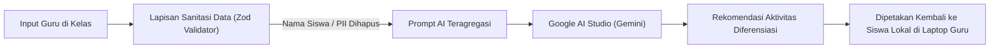

# Rencana Keamanan & Privasi Data: Multigrade Cerdas AI
## SDN SEDAENG II Tosari

---

## 1. Konteks Keamanan Sekolah Dasar Pedesaan

Karakteristik operasional SDN SEDAENG II Tosari menghadirkan tantangan keamanan unik:
* **Perangkat Bersama (*Shared Devices*):** Satu laptop atau komputer ruang guru sering kali digunakan bergantian oleh beberapa guru.
* **Konektivitas Tidak Stabil:** Saat internet mati, data tersimpan sementara di penyimpanan lokal peramban (*browser local storage / IndexedDB*), sehingga membutuhkan perlindungan dari akses lokal tanpa izin.
* **Data Sensitif Anak (Perlindungan Anak & UU PDP No. 27/2022):** Privasi 27 anak di sekolah ini wajib dilindungi dari kebocoran data, terutama saat berinteraksi dengan model kecerdasan buatan (*generative AI*).

---

## 2. Kebijakan Privasi Data Siswa (Zero-PII Leak ke AI)

Model AI (Google AI Studio / Gemini API) digunakan semata-mata untuk penyusunan materi pengajaran dan rancangan asesmen umum, **bukan** untuk pemrofilan individu siswa.

### Prinsip Sanitasi Data:
1. **Pseudonimisasi Siswa:** Sistem menggunakan format kode siswa anonim (contoh: `SDN2-A-01`, `SDN2-B-07`) dan nama panggilan pendek di UI lokal.
2. **Larangan Penyimpanan Data Sensitif:** Sistem tidak mengumpulkan NIK, NISN, alamat rumah lengkap, maupun data biometrik/medis siswa.
3. **Penyaringan Prompt AI (*AI Prompt Filtering*):** Semua interaksi dengan Gemini API berjalan melalui modul backend di [src/lib/ai/](file:///c:/Users/UseR/Videos/Antigravity%20Project/MULTIGRADE%20CERDAS/src/lib/ai/) yang secara otomatis menghapus pola identitas sebelum payload dikirim ke Google AI Studio.

---

## 3. Manajemen Rahasia & Kredensial API

1. **Google AI Studio API Key:**
   * Kunci disimpan di berkas `.env` server-side (`GEMINI_API_KEY`).
   * Dilarang menggunakan awalan `NEXT_PUBLIC_` untuk kunci API Google AI Studio agar kunci tidak pernah terkompilasi ke dalam bundel JavaScript sisi klien.
2. **Kredensial Database:**
   * `DATABASE_URL` hanya dapat diakses oleh runtime server Next.js dan Drizzle Kit.
   * Parameter koneksi dilindungi dan diisolasi dari repositori publik melalui `.gitignore`.

---

## 4. Kontrol Akses Berbasis Peran (Role-Based Access Control / RBAC)

| Peran | Hak Akses | Batasan |
|---|---|---|
| **Guru Kelas Rangkap (*Teacher*)** | Mengisi modul ajar kelompoknya, menginput asesmen harian, melihat kemajuan 27 siswa. | Tidak dapat mengubah skema mata pelajaran inti atau menghapus akun guru lain. |
| **Kepala Sekolah (*Headmaster*)** | Memantau seluruh kelompok (A, B, C), mencetak laporan ketercapaian TP, melihat audit log. | Tidak dapat mengubah kode sumber sistem. |
| **Administrator (*Admin*)** | Mengelola akun guru, konfigurasi database, dan monitoring sinkronisasi offline. | Menjaga integritas infrastruktur teknis. |

### Mekanisme Pengamanan Sesi di Laptop Bersama:
* **Kunci Sesi Otomatis (*Auto-lock*):** Sesi dikunci otomatis jika tidak ada aktivitas dalam 20 menit guna melindungi layar saat guru mendampingi siswa di sudut kelas lain.
* **Pembersihan Cache Logout:** Tombol Logout secara eksplisit menghapus token sesi dan mengosongkan *in-memory cache* sensitif.

---

## 5. Pertahanan Terhadap Kerentanan Web (OWASP Top 10)

1. **Injeksi SQL:**
   * Menggunakan Drizzle ORM yang mengonversi kueri ke *parameterized queries* secara bawaan. Tidak ada kueri mentah (*raw SQL string concatenation*).
2. **Validasi Input Ketat (Zod Schemas):**
   * Seluruh data yang masuk dari formulir maupun API diverifikasi tipenya, panjang karakternya, dan formatnya di [src/lib/validations/](file:///c:/Users/UseR/Videos/Antigravity%20Project/MULTIGRADE%20CERDAS/src/lib/validations/index.ts).
3. **Cross-Site Scripting (XSS):**
   * React 19 melakukan escaping otomatis pada teks yang dirender.
   * Penerapan header HTTP keamanan (*Content Security Policy*, `X-Content-Type-Options: nosniff`, `X-Frame-Options: DENY`).
4. **Verifikasi Integritas Sinkronisasi Offline:**
   * Setiap paket sinkronisasi dari IndexedDB ditandatangani dengan ID sesi aktif dan divalidasi skemanya sebelum diterima oleh database server.

---

## 6. Rencana Tanggap Insiden Keamanan

Jika terjadi kehilangan perangkat sekolah atau dugaan kompromi akun:
1. **Pencabutan Kunci API:** *Rotate* `GEMINI_API_KEY` seketika di konsol Google AI Studio.
2. **Reset Kunci Sesi:** Cabut sesi aktif pengguna di database melalui Server Action admin.
3. **Audit Log:** Periksa riwayat mutasi data di tabel `offline_sync_logs` untuk memastikan tidak ada perubahan nilai fiktif atau akses tidak sah.
